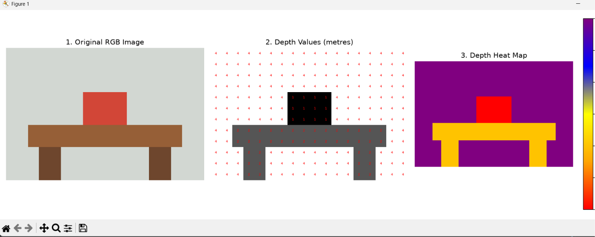
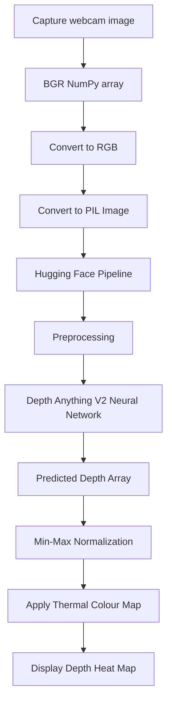

# 3D Computer Vision — Project Notes

## High-Level Explanation

The way depth maps work is instead of a 3-channel array of pixels, it's a 1-channel array of predicted depth. There are already pretrained models that do this, like the one we use in this project.

Depth prediction is **RELATIVE**. The model doesn't actually know how far the coffee mug is from the webcam. It could be a 200 ft tall coffee mug held by a 10,000 ft tall human in a 10,000,000 ft tall cafe. All the computer knows is the **RELATIVE depth** (which is actually still pretty cool).

### Side Note: Sensor Fusion

Sensor fusion can help us estimate actual distances, and this is where 3D mapping gets really cool.

Adding things like:
- ToF sensor
- Sonar
- Motion parallax

On top of traditional depth estimation using simply the camera.

---

## Manual Depth Map

The manual depth map is just to understand what these neural networks do.

Essentially, they are passed an image and predict how far things are away **RELATIVE to each other**.

So in our simple example, the cup had values of 1, while the white background had values of 4.

This allows us to make a simple heat map for proof of concept.

---

## AI_depth Program

This program uses an actual Hugging Face model called **Depth Anything V2** and runs an image from our webcam through it to make a depth map.

### Program Flowchart

### Step 1: Capture Image

Capture the image using the basic `cv2` procedure.

When you press Space, the video feed ends and the last frame is stored in the variable `frame`.

### Step 2: Prepare Image

Convert the BGR array into RGB and eventually a PIL Image, which is what we're passing to our neural network pipeline.

A PIL Image is basically just an image object. It's simply a different way to represent and work with image data.

### Steps 3–4: Neural Network Inference

Load the pretrained neural network.

Pass our image through the pipeline.

The pipeline is just a Hugging Face function that preprocesses and normalizes our input data, feeds it into the neural network, and then postprocesses the output.

The neural network produces our predicted depth array.

### Step 5: Normalize Depth Values

Normalize all the predicted values so they're between 0 and 1 for consistency in our depth map visualization.

We use **Min-Max Normalization**, not sigmoid.

### Steps 6–7: Visualize the Depth Map

Create the actual heat map visualization using the predicted depth array.

We use a thermal-style colour map:
- **Red:** Closer
- **Yellow:** Intermediate
- **Blue/Purple:** Farther

The colours are just for visualization. The actual depth map is the numerical array.

---

## Results

### My First AI Depth Map

## Depth Sandbox ##
 was an addition on top of AI_depth to explore the depth map by clicking different points and start to begin exploring point clouds. 
 used codex to do this part. 
 *side note* really cool to see the 3d point cloud and makes it clearer to understand how a moving camera could create pretty accurate 3d scans